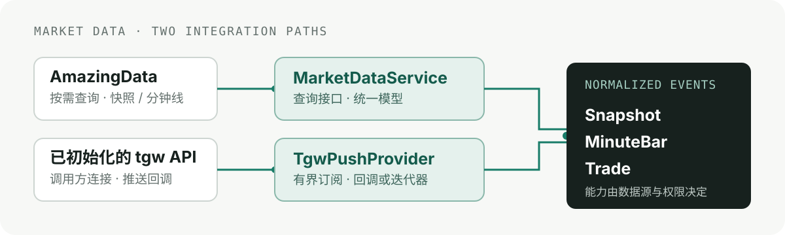

# A500 T-Trader

面向量化工具使用者：按实时推送行情与 V1 策略规则生成结构化交易信号。项目不以量化研究框架或严格回测为目标。

## 能力

- **按需查询：** `MarketDataService` 提供快照、当日分钟线和历史分钟线查询；支持 1 分钟与 5 分钟周期。
- **推送订阅：** `TgwPushProvider` 适配调用方已初始化的 tgw API，可订阅快照、分钟线和逐笔成交。
- **统一数据模型：** 查询与推送使用 `Snapshot`、`MinuteBar`、`Trade`；时间戳统一为 `Asia/Shanghai`。
- **显式能力边界：** 当前 AmazingData provider 不支持按需成交查询；数据可用性取决于连接方式、账号权限和数据源能力。
- **实时策略信号：** `live-signals` 消费注入的 push provider，以明确配置的 ETF 与已完成五分钟行情评估 V1 信号；无认证门槛，不连接券商、不验证券商账户、不下单。

## 使用

详细的安装、认证配置和依赖准备步骤见[项目依赖说明](docs/dependencies.md)与[使用指南](docs/user-guide.md)。盘前计划与历史回测是独立能力；实时信号命令、YAML 配置及 V1 参数决策见 [ADR-0009](docs/adr/0009-live-signals-and-configurable-v1-parameters.md)。

项目要求 Python 3.14。所有信号及数量建议均为参考信息，不是订单、成交或收益承诺。

## 开发与贡献

开发环境、质量检查、提交规范和 CI 说明见[开发与贡献指南](docs/contributing.md)。
