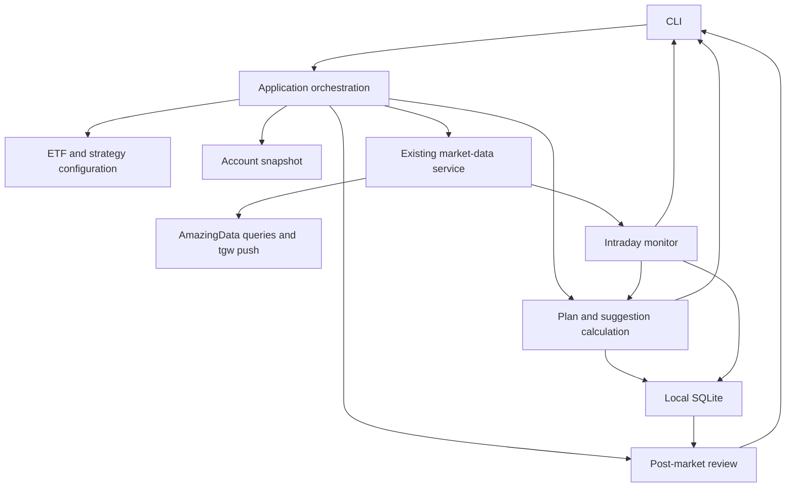

# Keep the daily ETF strategy advisory-only

## Status

Accepted

## Context

The repository provides normalized market-data queries and push subscriptions, startup configuration, and a Shanghai trading calendar. The first strategy capability is a single-account daily T-assistant for a user-maintained list of on-exchange broad-market index ETFs. It produces a pre-market plan, monitors intraday minute bars, and produces a post-market review. Users provide account snapshots and strategy rules. No verified broker-account or execution capability exists.

## Decision

Keep the strategy advisory-only and separate from execution. The system does not connect to a broker or place orders. It produces explainable, risk-gated suggestions; account snapshots and actual trade records are user-entered and remain distinct from strategy suggestions and simulated fills.

Users operate the first version through a CLI: load configuration, generate the pre-market plan, start intraday monitoring, and generate the post-market review. ETF lists and strategy rules are read from local configuration files. The monitor runs only while started by the user; the first version has no unattended background service, web interface, automatic strategy discovery, or optimization.

Keep the existing vendor-neutral market-data service and provider boundary. Strategy logic consumes normalized data and trading-calendar status; unavailable or unauthorized data capabilities are reported explicitly. The intraday monitor evaluates configured conditions using minute bars, displays terminal alerts, and records trigger evidence. Suggestions include conditions or price levels, quantity, rationale, and risk or expiry notes; a terminal alert is not an order.

The application is divided into these responsibilities:

| Module                          | Responsibility                                                                                                                         |
| ------------------------------- | -------------------------------------------------------------------------------------------------------------------------------------- |
| CLI                             | Load inputs; invoke pre-market planning, user-started monitoring, and post-market review; display plans and alerts.                    |
| Application orchestration       | Coordinate the daily workflow across configuration, account state, market data, planning, monitoring, persistence, and review.         |
| ETF and strategy configuration  | Read the user-maintained ETF list and explicitly user-defined rules from local files.                                                  |
| Account snapshot                | Supply the single account's user-entered holdings, cost basis, and available quantities; this is not a verified broker balance.        |
| Market-data service             | Reuse normalized market-data queries, push subscriptions, and trading-calendar status.                                                 |
| Plan and suggestion calculation | Apply configured rules to market data and account state; produce explainable, risk-gated plans and suggestions without executing them. |
| Intraday monitor                | Evaluate configured conditions using minute bars while running; display terminal alerts and record trigger evidence.                   |
| Persistence                     | Store application state and history locally in SQLite.                                                                                 |
| Post-market review              | Use saved plans, triggers, and available market data to produce the daily review.                                                      |

SQLite is selected for local history. Persist account snapshots, strategy/grid state, signal history, manual fills, and historical market bars through this store. Retain daily bars for indicator calculation and minute bars for backtests. The vendor-neutral market-data boundary must support daily-bar queries; the current history-query API only supports minute bars. The CLI provides separate commands for daily-history/indicator work and minute-history/backtest work. Re-querying a bar replaces the shared stored value for the same symbol, interval, and timestamp. Retain shared bars until explicit user cleanup; do not persist a full tick stream by default.

Each backtest records its explicit future-bar fill assumptions, costs, and slippage; retains an immutable snapshot of the exact minute bars it used; and records its strategy parameters and implementation version. Backtest records reference these snapshots. Clearing shared market-history data must not delete snapshots referenced by backtests. Persist or reuse AmazingData data only where its applicable service terms permit; confirm those terms before enabling persistence.

Backtests and simulations enforce T+1 and the minimum holding floor, and compare against a same-initial-conditions hold baseline. Risk controls can veto any strategy output; unavailable or stale required inputs prevent a tradable quantity recommendation.

## Consequences

- Suggestions, user-entered account state, manual fills, and simulated fills remain distinct.
- Actual source capabilities, permissions, and data quality may constrain ETF coverage and intraday inputs; the application must not fabricate unavailable data.
- The initial workflow is local and user-operated; it does not include server deployment or remote notifications.
- Strategy formulas and configuration fields are defined when the user's concrete rules are specified; this decision does not invent them.

### Daily flow

